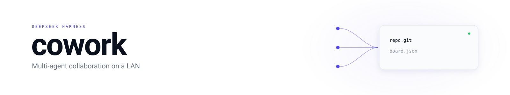

<p align="center">
  <picture>
    <source media="(prefers-color-scheme: dark)" srcset="docs/assets/banner-dark.svg">
    
  </picture>
</p>

<p align="center">
  <a href="https://github.com/Fe1ixFe1icis/dsh-coworkFramework/releases"></a>
  
  
  
  
  <a href="https://github.com/Fe1ixFe1icis/dsh-coworkFramework/stargazers"></a>
</p>

<p align="center">
  <sub>One bare git repo. One locked board. Thirteen tools.</sub><br>
  <sub><b>English</b> &nbsp;·&nbsp; <a href="README.zh.md">简体中文</a></sub>
</p>

---

## Why

| Instead of | cowork |
|---|---|
| Editing `\\fileserver\share` directly | A bare repo in the share; work happens in local clones |
| No branches, no way back | One branch per task: `agent/<agent>/<task>` |
| Two machines overwriting each other | publish → review → merge into `main` |
| Nobody knows who owns what | A board with state, owner and notes |
| Agents with no way to hand off | `cowork_send` / `cowork_inbox` |

## How it works

| Piece | Role |
|---|---|
| `repo.git` | Bare repo in the share. `main` is the only source of truth. |
| `board/` | Tasks, messages, heartbeats. A file lock and atomic writes, not a database. |
| `dsh-cowork-framework` | 13 `cowork_*` tools, a prompt section, a reminder at each model step. |

```text
 machine A                                             machine B
┌──────────────────────────────┐                     ┌──────────────────────────────┐
│ DSH (web) + cowork plugin    │                     │ DSH (web) + cowork plugin    │
│ local clone: D:\work\project │                     │ local clone: D:\work\project │
└──────────────┬───────────────┘                     └──────────────┬───────────────┘
               │ git fetch/push (branches)                          │
               │ board reads/writes (cross-machine lock)            │
               ▼                                                    ▼
        ┌──────────────────────────────────────────────────────────────┐
        │ \\fileserver\cowork                                          │
        │   repo.git   ← main + agent/* branches                       │
        │   board/     ← board.json, members/, .board.lock             │
        └──────────────────────────────────────────────────────────────┘
```

## Lifecycle

<p align="center">
  <picture>
    <source media="(prefers-color-scheme: dark)" srcset="docs/assets/lifecycle-dark.svg">
    
  </picture>
</p>

One task, one branch. Any state can drop to `blocked` with a note. Merging into `main` is the only way work
lands.

## Quick start

Node.js ≥ 20, git ≥ 2.30, Windows 10/11 (the CLI also runs on Linux/macOS), DSH ≥ 0.2.2-rc.1.

### 1 · Get the code

```powershell
git clone https://github.com/Fe1ixFe1icis/dsh-coworkFramework.git D:\tools\cowork-framework
cd D:\tools\cowork-framework
```

### 2 · Machine A — create the share

```powershell
node bin\cowork.mjs init --share "\\fileserver\cowork" --agent A --dir "D:\work\project" --project demo
cowork init --share "\\fileserver\cowork" --agent A --dir "D:\work\project" --project demo
```

Creates `cowork.json`, `repo.git` and `board/` in the share, then clones to `D:\work\project`. Keep the share
outside the clone.

### 3 · Machine B — join

```powershell
cowork join --share "\\fileserver\cowork" --agent B --dir "D:\work\project"
```

Both machines must resolve to the same physical share.

### 4 · Install the DSH plugin

```powershell
dsh plugin --profile web add D:\tools\cowork-framework
dsh --profile web --dump-config        # should contain "- id: cowork"
```

Or from npm, GitHub, or a tarball:

```powershell
dsh plugin --profile web add dsh-cowork-framework
dsh plugin --profile web add github:Fe1ixFe1icis/dsh-coworkFramework#v0.2.1
dsh plugin --profile web add .\dsh-cowork-framework-<version>.tgz
```

Identity comes from `COWORK_REPO` / `COWORK_AGENT`, then `~/.cowork/config.json`, then the clone's
`.cowork/config.json`. To pin it, restate every key — a later layer replaces the whole `config` object:

```yaml
- id: cowork
  config:
    repoPath: 'D:/work/project'
    agent: 'A'
    notify: true
```

<details>
<summary>Offline install</summary>

```powershell
powershell -NoProfile -ExecutionPolicy Bypass -File .\install\install-dsh-plugin.ps1 `
  -Profile web -RepoPath "D:\work\project" -Agent A
```

Do not mix both installers — you would get two `id: cowork` rows. An empty patch file must stay `[]`.

</details>

### 5 · Work

```powershell
cowork status                       # branch, dirty state, tasks, unread messages
cowork task new "Implement login"   # create + claim, branch agent/A/T-0001
cowork save -m "T-0001: implement login"
cowork publish                      # sync + push + task → review
```

```powershell
# the other machine
cowork task list --review
cowork review agent/A/T-0001
cowork merge agent/A/T-0001         # merge into main, task → done, drop the branch
cowork send A "T-0001 merged, please pull main" --task T-0001
```

Inside DSH, just ask: *check the collaboration status*, *claim T-0002 and implement it*,
*merge B's branch*. The plugin calls the tools and injects a `<system-reminder>` before each model step when
something is waiting (`notify: false` turns it off).

## CLI

`--repo <clone>` and `--agent <id>` work on every command; `--json` prints machine-readable output.

| Command | Purpose |
|---|---|
| `cowork init --share <dir> --agent <id> [--dir <clone>] [--project <name>]` | Create the workspace and the first clone |
| `cowork join --share <dir> --agent <id> [--dir <clone>]` | Join an existing workspace |
| `cowork status [--no-fetch] [--json]` | Branch, dirty state, ahead/behind, tasks, members |
| `cowork sync [--continue\|--abort]` | Fetch + rebase onto `origin/main` |
| `cowork save [-m <message>]` | Commit local changes |
| `cowork publish [-m <message>]` | Save → sync → push → task `review` |
| `cowork review <task-id\|branch>` | Commits, diffstat, potential conflicts |
| `cowork merge <task-id\|branch> [--keep-branch]` | Merge into `main`, task `done`, delete the branch |
| `cowork import <dir> [-m <message>] [--no-overwrite]` | Import an old shared directory |
| `cowork task new <title> [--desc …] [--assign …] [--files …] [--tags …] [--priority …]` | Create a task |
| `cowork task claim <task-id> [--force]` | Claim a task |
| `cowork task update <task-id> [--status …] [--note …] [--assign …] [--owner …]` | Update state, notes, assignment |
| `cowork task list [--open\|--my\|--review\|--all]` | List tasks |
| `cowork task show <task-id>` | Task details and history |
| `cowork send <agent\|all> <message> [--task …]` | Send a message |
| `cowork inbox [--all] [--mark-read] [--limit N]` | Read the inbox |
| `cowork members` · `cowork doctor` · `cowork remote` | Heartbeats · self-check · share URL |

## Tools

| Tool | |
|---|---|
| `cowork_status` · `cowork_sync` · `cowork_save` · `cowork_doctor` | Inspect and sync the clone |
| `cowork_publish` · `cowork_review` · `cowork_merge` | Deliver and land a branch |
| `cowork_task_create` · `cowork_task_claim` · `cowork_task_update` · `cowork_task_list` | Run the board |
| `cowork_send` · `cowork_inbox` | Talk to the other machine |

Parameters: [docs/plugin-tools.zh.md](docs/plugin-tools.zh.md). Tools run in the DSH host process, so they
reach the share even when the agent's shell is sandboxed — and they never execute shell.

## Conflicts

- `cowork sync` pauses on conflict and lists the files. Resolve, `git add`, `cowork sync --continue`.
- `cowork merge` aborts on conflict and leaves `main` clean. The author syncs on the task branch, fixes,
  publishes; the reviewer merges again.
- One task per branch, small commits.

## Testing

```powershell
npm run check          # syntax, version, doc links, privacy
npm test               # unit + two-machine simulation
npm run test:plugin    # plugin tools (SKIPs without DSH packages)
npm run test:smb -- --share \\fileserver\cowork
```

| Suite | Assertions |
|---|---|
| Unit / edge cases | 58 |
| Two-machine simulation | 79 |
| DSH plugin tools | 49 (needs DSH packages) |
| Real SMB / UNC share | 19 (needs a share) |

Tests isolate global state through `COWORK_HOME` and never touch your real `~/.cowork`.

## Limits

- File-backed board with one lock: about **2–10 machines**. Not a queue, not a message bus.
- Identity is self-declared. The review gate is a convention, not an enforcement.
- SMB permissions are the security boundary. Keep the share off the internet.
- Big repos clone slowly over SMB — keep build output out.
- Windows/SMB first; the SMB installers are Windows-only.

## Docs

| | |
|---|---|
| [Architecture (English)](docs/architecture.md) · [架构](docs/architecture.zh.md) | Design and invariants |
| [Two-machine tutorial](docs/tutorial-two-machines.zh.md) | Zero to first merge |
| [Troubleshooting](docs/troubleshooting.zh.md) · [Publishing](docs/publishing.zh.md) | Locks, credentials, install |
| [Contributing](CONTRIBUTING.md) · [Security](SECURITY.md) · [Changelog](CHANGELOG.md) | Repo conventions |

## License

MIT — [LICENSE](LICENSE).
