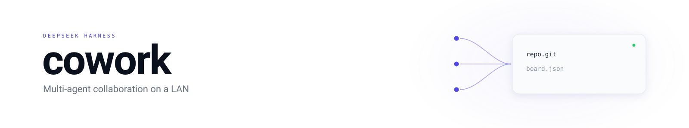

<p align="center">
  <picture>
    <source media="(prefers-color-scheme: dark)" srcset="docs/assets/banner-dark.svg">
    
  </picture>
</p>

<p align="center">
  <a href="https://github.com/Fe1ixFe1icis/dsh-coworkFramework/releases"></a>
  
  
  
  
  <a href="https://github.com/Fe1ixFe1icis/dsh-coworkFramework/stargazers"></a>
</p>

<p align="center">
  <sub>一个裸仓库，一份带锁任务板，13 个工具。</sub><br>
  <sub><a href="README.md">English</a> &nbsp;·&nbsp; <b>简体中文</b></sub>
</p>

---

## 为什么

| 原来 | cowork |
|---|---|
| 直接改 `\\fileserver\share` 里的文件 | 共享目录里放裸仓库，各自在本地克隆里干活 |
| 没有分支，改坏了回不去 | 一条任务一个分支：`agent/<身份>/<任务号>` |
| 两台机器互相覆盖 | publish → review → 合并进 `main` |
| 谁在做什么没人知道 | 任务板记录状态、认领人和备注 |
| agent 之间无法交接 | `cowork_send` / `cowork_inbox` |

## 结构

| 部件 | 作用 |
|---|---|
| `repo.git` | 共享目录里的裸仓库。`main` 是唯一事实来源。 |
| `board/` | 任务、消息、心跳。文件锁 + 原子写，不是数据库。 |
| `dsh-cowork-framework` | 13 个 `cowork_*` 工具、一个提示段、每个模型步进前的提醒。 |

```text
 机器 A                                               机器 B
┌──────────────────────────────┐                    ┌──────────────────────────────┐
│ DSH (web) + cowork 插件       │                    │ DSH (web) + cowork 插件       │
│ 本地克隆 D:\work\project      │                    │ 本地克隆 D:\work\project      │
└──────────────┬───────────────┘                    └──────────────┬───────────────┘
               │ git fetch/push（分支）                              │
               │ board 读/写（跨机器锁）                             │
               ▼                                                    ▼
        ┌────────────────────────────────────────────────────────────────┐
        │ \\fileserver\cowork                                            │
        │   repo.git   ← main + agent/* 分支                              │
        │   board/     ← board.json、members/、.board.lock                │
        └────────────────────────────────────────────────────────────────┘
```

## 状态流转

<p align="center">
  <picture>
    <source media="(prefers-color-scheme: dark)" srcset="docs/assets/lifecycle-dark.svg">
    
  </picture>
</p>

一条任务一个分支。任何状态都可以带备注落到 `blocked`。只有合并进 `main` 才算交付。

## 快速开始

需要 Node.js ≥ 20、git ≥ 2.30、Windows 10/11（CLI 也能在 Linux/macOS 跑）、DSH ≥ 0.2.2-rc.1。

### 1 · 获取代码

```powershell
git clone https://github.com/Fe1ixFe1icis/dsh-coworkFramework.git D:\tools\cowork-framework
cd D:\tools\cowork-framework
```

### 2 · 机器 A：初始化共享目录

```powershell
node bin\cowork.mjs init --share "\\fileserver\cowork" --agent A --dir "D:\work\project" --project demo
cowork init --share "\\fileserver\cowork" --agent A --dir "D:\work\project" --project demo
```

在共享目录生成 `cowork.json`、`repo.git`、`board/`，然后克隆到 `D:\work\project`。共享目录要放在克隆
之外。

### 3 · 机器 B：加入

```powershell
cowork join --share "\\fileserver\cowork" --agent B --dir "D:\work\project"
```

两台机器必须指向同一个物理共享目录。

### 4 · 安装 DSH 插件

```powershell
dsh plugin --profile web add D:\tools\cowork-framework
dsh --profile web --dump-config        # 应包含 "- id: cowork"
```

也支持 npm 包、GitHub 引用或 tarball：

```powershell
dsh plugin --profile web add dsh-cowork-framework
dsh plugin --profile web add github:Fe1ixFe1icis/dsh-coworkFramework#v0.2.1
dsh plugin --profile web add .\dsh-cowork-framework-<version>.tgz
```

身份按 `COWORK_REPO` / `COWORK_AGENT` → `~/.cowork/config.json` → 克隆里的 `.cowork/config.json` 解析。
要固定值就按 id 覆盖——后叠加的层会整体替换 `config`，键要写全：

```yaml
- id: cowork
  config:
    repoPath: 'D:/work/project'
    agent: 'A'
    notify: true
```

<details>
<summary>离线安装</summary>

```powershell
powershell -NoProfile -ExecutionPolicy Bypass -File .\install\install-dsh-plugin.ps1 `
  -Profile web -RepoPath "D:\work\project" -Agent A
```

两种方式不要混用，否则会出现两个 `id: cowork` 行；空 patch 文件必须保留 `[]`。

</details>

### 5 · 开始干活

```powershell
cowork status                       # 分支、工作区、任务、未读消息
cowork task new "实现登录页"         # 新建并认领，建分支 agent/A/T-0001
cowork save -m "T-0001: 完成登录页"
cowork publish                      # 同步 + 推送 + 任务置 review
```

```powershell
# 另一台机器
cowork task list --review
cowork review agent/A/T-0001
cowork merge agent/A/T-0001         # 合并进 main，任务 done，删除分支
cowork send A "T-0001 已合并，请拉取 main" --task T-0001
```

在 DSH 里不用记命令，直接说「看一下协作状态」「认领 T-0002 然后实现」「把 B 的分支合并」。有未读消息或
待合并任务时，插件会在每个模型步进前注入一条 `<system-reminder>`（`notify: false` 可关闭）。

## 命令行

所有命令都支持 `--repo <克隆>`、`--agent <身份>`；`--json` 输出机器可读数据。

| 命令 | 作用 |
|---|---|
| `cowork init --share <目录> --agent <身份> [--dir <克隆>] [--project <名称>]` | 初始化工作区 + 第一个克隆 |
| `cowork join --share <目录> --agent <身份> [--dir <克隆>]` | 加入已有工作区 |
| `cowork status [--no-fetch] [--json]` | 分支、工作区、领先/落后、任务、成员 |
| `cowork sync [--continue\|--abort]` | fetch + rebase 到 `origin/main` |
| `cowork save [-m <说明>]` | 提交当前分支改动 |
| `cowork publish [-m <说明>]` | 保存 → 同步 → 推送 → 任务置 review |
| `cowork review <任务号\|分支>` | 提交、改动统计、潜在冲突 |
| `cowork merge <任务号\|分支> [--keep-branch]` | 合并进 main、任务 done、删远程分支 |
| `cowork import <目录> [-m <说明>] [--no-overwrite]` | 导入旧的共享目录 |
| `cowork task new <标题> [--desc …] [--assign …] [--files …] [--tags …] [--priority …]` | 新建任务 |
| `cowork task claim <任务号> [--force]` | 认领任务 |
| `cowork task update <任务号> [--status …] [--note …] [--assign …] [--owner …]` | 改状态、备注、指派 |
| `cowork task list [--open\|--my\|--review\|--all]` | 任务列表 |
| `cowork task show <任务号>` | 任务详情与历史 |
| `cowork send <身份\|all> <消息> [--task …]` | 发跨机器消息 |
| `cowork inbox [--all] [--mark-read] [--limit N]` | 收件箱 |
| `cowork members` · `cowork doctor` · `cowork remote` | 心跳 · 自检 · 仓库地址 |

## 工具

| 工具 | |
|---|---|
| `cowork_status` · `cowork_sync` · `cowork_save` · `cowork_doctor` | 查看与同步克隆 |
| `cowork_publish` · `cowork_review` · `cowork_merge` | 交付与落地分支 |
| `cowork_task_create` · `cowork_task_claim` · `cowork_task_update` · `cowork_task_list` | 操作任务板 |
| `cowork_send` · `cowork_inbox` | 和另一台机器说话 |

参数见 [docs/plugin-tools.zh.md](docs/plugin-tools.zh.md)。工具跑在 DSH 宿主进程里，所以 shell 被沙箱
限制时也能读写共享目录；它们只调用 cowork 的业务函数，不执行 shell。

## 冲突

- `cowork sync` 遇到冲突会暂停并列出文件。解决 → `git add` → `cowork sync --continue`。
- `cowork merge` 遇到冲突自动中止，`main` 保持干净。作者在任务分支上 sync、解决、publish，再重新合并。
- 一条任务一个分支，小步提交。

## 测试

```powershell
npm run check          # 语法、版本、文档链接、隐私
npm test               # 单元 + 两机模拟
npm run test:plugin    # 插件工具（缺 DSH 包时 SKIP）
npm run test:smb -- --share \\fileserver\cowork
```

| 测试 | 断言数 |
|---|---|
| 单元/边界 | 58 |
| 两机模拟 | 79 |
| 插件工具 | 49（需要 DSH 包） |
| 真实 SMB 共享目录 | 19（需要共享目录） |

测试通过 `COWORK_HOME` 隔离全局配置，不会动真实的 `~/.cowork`。

## 边界

- 文件型任务板 + 单锁：约 **2–10 台机器**。不是队列，也不是消息总线。
- 身份是自报的；review 是约定，不是强制门禁。
- 安全边界是 SMB 权限，别把共享暴露到公网。
- 大仓库经 SMB 克隆会慢，构建产物别入库。
- Windows/SMB 优先，SMB 安装脚本仅限 Windows。

## 文档

| | |
|---|---|
| [架构](docs/architecture.zh.md) · [Architecture (English)](docs/architecture.md) | 设计与不变量 |
| [两机安装教程](docs/tutorial-two-machines.zh.md) | 从零到第一次合并 |
| [排障手册](docs/troubleshooting.zh.md) · [发布与安装](docs/publishing.zh.md) | 锁、凭据、安装 |
| [贡献指南](CONTRIBUTING.md) · [安全策略](SECURITY.md) · [更新日志](CHANGELOG.md) | 仓库约定 |

## 许可证

MIT，见 [LICENSE](LICENSE)。
